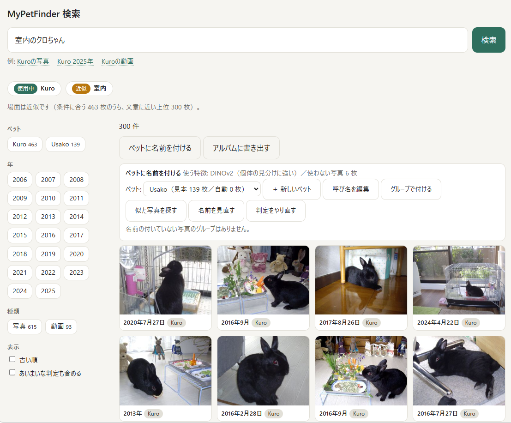
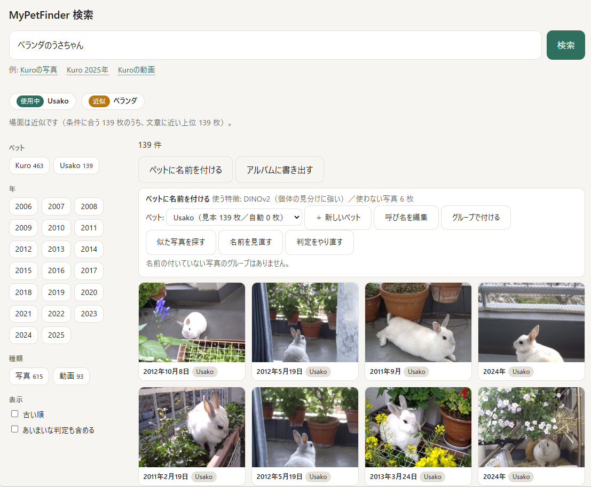

# MyPetFinder

パソコンに保存した**ペットの写真・動画**を、名前や年、場面で探せるアプリです。
**写真・動画は、このパソコンの外に出ません**（解析も検索も、すべてこのパソコンの中で行います）。元の写真・動画は変更しません（読むだけです）。

> 個人の趣味のプロジェクトです。試作版（v0.1）で、動作や対応は保証できません。問い合わせの窓口は設けていません。大切な写真は、必ずバックアップを取ってからお使いください。

紹介ページ: https://usakowhity.github.io/MyPetFinder/

## 画面の例
「室内のクロちゃん」（別の呼び名「クロちゃん」でも、登録名の写真が見つかります。「室内」は文章に近い写真を並べる近似です）

「ベランダのうさちゃん」

## 動作環境
- Windows 10 / 11（64ビット）
- 空き容量 約3GB以上（部品とモデルで約1GB。解析結果と縮小画像は、写真の枚数に応じて `data` フォルダに増えます）
- メモリ 8GB 以上を目安
- 初回だけ、インターネット接続が必要（Python・部品・AIモデルを取得します。以後は、不要です）
- パソコンのCPUだけで動かします。**時間がかかります**（目安は下の「解析にかかる時間」）。

## 使い方
1. zip を、書き込める場所（例: `D:\MyPetFinder`）に展開します。フォルダ名や場所に、`Program Files` は避けてください。
2. **`start_finder.bat`** をダブルクリックします。初回は、Python と部品を自動で取り込みます（数分）。Windows が「保護されました」と出たら、「詳細情報」→「実行」を選びます。
3. ブラウザが開き、**写真・動画のあるフォルダ**を聞かれます。1行に1つ、フルパスで入れます（例: `D:\写真`）。候補のボタンも使えます。
4. 検索画面の **「解析を始める」** を押します。写真→動画の順に解析します。途中で閉じても、次回、続きから再開します。
5. **「ペットに名前を付ける」** を押します。
   - 「＋ 新しいペット」で、名前と種類（例: ウサギ、犬、ネズミ）を登録します。
   - 似た写真のグループが出ます。同じ子のグループを選んで「全部この子です」。人形や他人の子などは「使わない」。
   - **全部のグループに名前を付ける必要はありません。** 名前を付けた分だけ検索でき、付けた分を見本に、残りの写真・動画も自動で判定します。
6. 検索ボックスに「ポチ」「ポチ 2020年」「ポチの動画」などを入れて検索します。検索結果の写真をダブルクリックすると、大きく表示します。
7. 気に入った結果は、「アルバム書き出し」で、別の場所にコピーできます（元の写真は、そのまま残ります）。

## 解析にかかる時間（目安）
CPUだけで動かすため、枚数が多いと長くかかります。**まず、少量のフォルダで試すこと**をお勧めします。実測の例（個人のパソコン）は、写真約3万4千枚のペット特徴の抽出に約40分、動画約3千本の取り込みに、さらに長い時間でした。パソコンによって、大きく変わります。

## できること・できないこと
- **種類の違うペット**（ウサギ・犬・猫・ネズミ・ハムスターなど）の組み合わせ、または1匹だけ。同じ種類でも、毛色や顔つきが違えば、別々に名前を付けられます。
- 同じ種類で、**見た目がそっくりな子どうし**（白いラット2匹など）は、写真だけでは区別できません。アプリが、取り違えやすい組を見つけると、警告を出します。
- 動画は、約6秒に1コマ（3〜12コマ）を取り出して判定します。ペットが複数のコマに写っていれば確実、1コマだけなら自信は低めです。
- 場面の検索（「海」「ケージの中」など）は、**目安**です。外れることがあります。
- 人物・場所の学習は、この版には含みません。

## 困ったときは
個人の趣味のプロジェクトのため、**問い合わせの窓口（Issues など）は設けていません。** 次の方法で、ご自身で試してください。ソースコードは MIT ライセンスなので、自由に改造・再配布できます。
- **黒い画面にエラーが出た**: いったん閉じて、`start_finder.bat` をもう一度実行してください。解析は、続きから再開します。
- **最初のセットアップ（Python・部品の取得）に失敗した**: インターネットに接続して、`python` フォルダを削除し、`start_finder.bat` をもう一度実行してください。
- **解析をやり直したい**: アプリを閉じて、`data` フォルダを削除すると、最初からになります（名前付けの結果も消えます）。
- **アンインストール**: フォルダごと削除します。レジストリなどは、使いません。

## プライバシー
- 写真・動画・解析結果は、`data` フォルダ（このフォルダの中）にだけ保存されます。インターネットには送りません。
- インターネットを使うのは、初回に、Python・部品・AIモデルを取得するときだけです。
- 検索画面は、このパソコンの中（127.0.0.1）でしか開けません。

## ライセンス
本体は MIT ライセンスです（`LICENSE`）。使っている部品とモデルのライセンスは `THIRD_PARTY_NOTICES.md` を見てください。モデルは配布物に含まれず、初回に配布元から取得します。
AI（Claude）の支援を受けて作っています。
